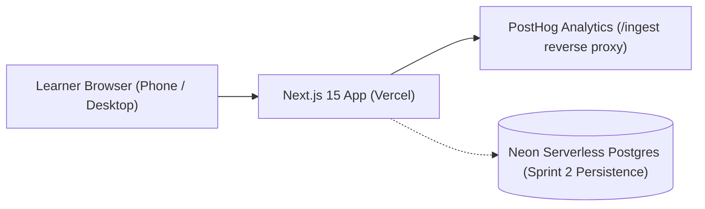

# Architecture

**Save this file as:** `03-build/architecture/architecture.md`

One diagram, one line of why per layer. Designed for reliable, zero-config deployment by Week 7.

## The diagram

## The stack, one line per layer

| Layer | Choice | Why we can deploy it by Week 7 (who has done it before, or the free tier that makes it easy) |
|---|---|---|
| Hosting | Vercel | Free Hobby tier connects directly to our GitHub repository with automatic builds and instant HTTPS preview URLs. |
| App framework | Next.js 15 (TypeScript + Tailwind CSS) | Industry standard React App Router with instant TypeScript type-checking and unified API routes. |
| Database | Neon Postgres (Serverless) | Provisioned Frankfurt region database with zero-setup serverless connection pooling via `@neondatabase/serverless`. |
| Analytics | PostHog Cloud (EU) | Fixed for the course; reverse-proxied via `/ingest` in `next.config.ts` to prevent client ad-blocker dropoff. |
| Messages out | None in Sprint 1 | Not required for the single-screen commitment journey. |
| Sign-in | None in Sprint 1 | Deliberately omitted to eliminate onboarding friction; learners commit to their stack immediately. |

**Layers we deliberately do not have in Sprint 1:** No authentication/login, no multi-tenant database migrations, and no background workers.

## The journey through the stack

| Step | Layer that handles it | Event fired |
|---|---|---|
| 1 · Learner opens app | Browser + Vercel CDN | `learner_opens_app` |
| 2 · Learner picks project category | Client React state | `learner_selects_category` |
| 3 · Learner reviews locked stack | Client React component | - |
| 4 · Learner clicks "Commit to This Stack" | Client handler | `user_commits_stack` ★ (North Star) |
| 5 · Learner checks Day 1 milestones / copies command | Client clipboard & state | `starter_command_copied`, `milestone_step_toggled` |

## Secrets and data

- **Secrets live in:** `app/.env.local` (and Vercel Project Environment Variables). `.env*` is confirmed listed in `.gitignore` at the repository root.
- **Personal data we store, and where:** Zero personal PII is collected or stored. Event payloads strictly carry generic project categories (`project_category`), stack names (`stack_name`), and arbitrary project idea text strings.
- **The one thing in this design most likely to break on deploy day:** PostHog ingest rewrite proxy if `NEXT_PUBLIC_POSTHOG_KEY` is omitted in Vercel project environment settings.
